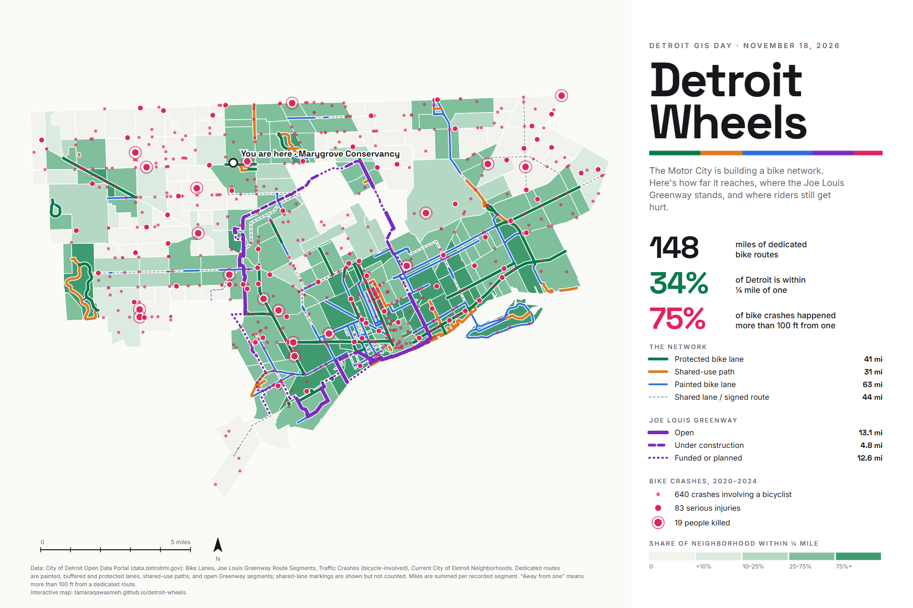

# Detroit Wheels

**A story map for [Detroit GIS Day 2026](https://www.detroitgisday.com/), held November 18, 2026 at Marygrove Conservancy.**

The Motor City is building a bike network. *Detroit Wheels* maps how far that network reaches, where the Joe Louis Greenway stands, and where riders still get hurt, using only City of Detroit open data. It's styled like a transit map.



## What it shows

| | |
|---|---|
| Dedicated bike routes | **~148 miles** (painted, buffered and protected lanes, shared-use paths, open Greenway) |
| Protected lanes | 41 miles |
| Joe Louis Greenway | 13.1 mi open · 4.8 mi under construction · 12.6 mi funded or planned |
| Detroit within ¼ mile of a dedicated route | **~34%** of the city's area; 66 of 205 neighborhoods have none |
| Bicycle-involved crashes, 2020–2024 | **640**, including 19 deaths and 83 serious injuries |
| Crashes more than 100 ft from a dedicated route | **75%** of those inside the city |

## What's in this repo

- `index.html`, `css/`, `js/`: an interactive scrollytelling map built with Leaflet, in six chapters: network, protection, the Greenway, reach, crashes, and calmer streets.
- `poster/detroit-wheels-poster-36x24.pdf`: a print-ready 36 × 24 in poster. `poster/poster.svg` is the vector source.
- `data/`: processed GeoJSON used by the map. `data/raw/` holds the original downloads.
- `scripts/`: the reproducible pipeline.

## Data sources (City of Detroit Open Data Portal)

- Bike Lanes (bike routes and facilities, with facility type)
- Joe Louis Greenway Route Segments (with phase: open, under construction, funded, unfunded)
- Traffic Crashes 2020–2024, filtered to `is_bicycle_involved`
- Detroit Slow Streets and Safe Streets for Detroit Corridors
- MoGo Stations and Bicycle Repair Stations
- Current City of Detroit Neighborhoods

Basemap: Esri World Light Gray Canvas.

## Method and limitations

- **Dedicated routes** are painted, buffered and protected bike lanes, shared-use paths, and open Joe Louis Greenway segments. Shared-lane markings and signed routes are drawn but not counted.
- **Miles** are summed from each segment as recorded, so overlapping segments (for example a path that is also part of the Greenway) may be counted twice.
- **Reach** is the share of a 150-meter grid of sample points in each neighborhood that lies within 402 m (¼ mile) of a dedicated route, measured as straight-line distance.
- **Crash distance** is the straight-line distance from each crash to the nearest dedicated route. Crash points outside city neighborhoods are excluded from the percentage.
- The city's **Greenways** layer is not used, because it doesn't distinguish built routes from planned ones.
- Most Slow Streets segments have no completion year, so they're shown as one layer rather than a timeline.

## Rebuild

```bash
python scripts/fetch_data.py      # download fresh data
python scripts/build_data.py      # analyze -> data/*.geojson
python scripts/build_poster.py    # render poster/poster.svg + poster.html
python -m http.server 8000        # then open http://localhost:8000
```

Python 3.9+ only, with no third-party packages. To export the PDF, print `poster/poster.html` from Chrome or Edge with no margins.

See also [The Care Mile](https://github.com/tamaraqawasmeh/detroit-care-mile) and [The Lead Line](https://github.com/tamaraqawasmeh/detroit-lead-line).
